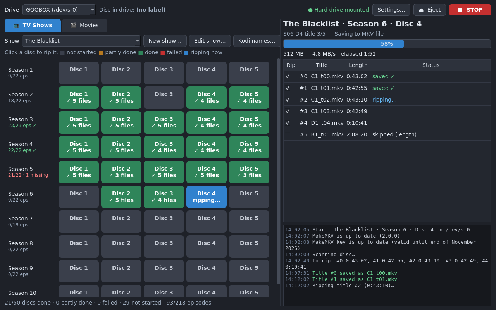
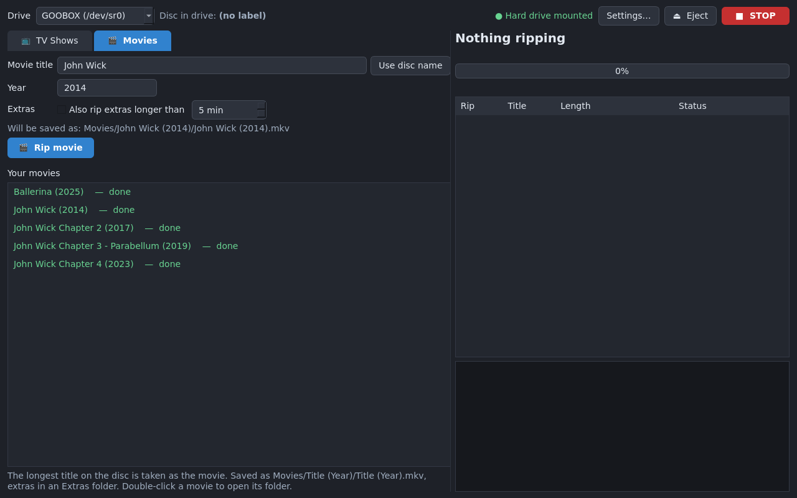
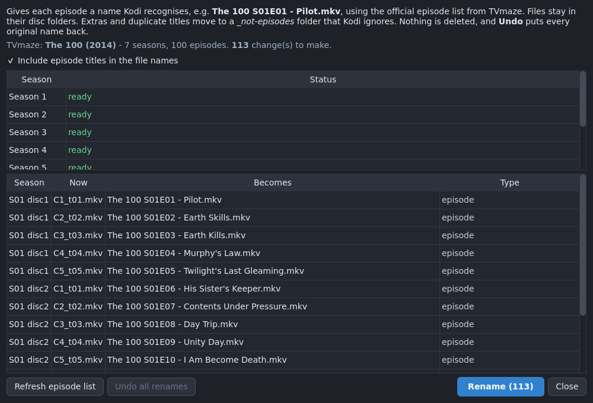

# Disc Ripper

A desktop app for ripping your own DVD/Blu-ray **TV box sets** (disc by disc) and **movies** to `.mkv` files, using
[MakeMKV](https://www.makemkv.com/) to do the actual reading. Built with Python + PySide6 (Qt).

Made for Linux (developed on Kali/Debian with Xfce). It's written so it can be ported to macOS or Windows; see
[Porting](#porting-to-macos--windows) below.

> For backing up discs you own. Whether breaking a disc's copy protection is legal depends on your country.



**Get it:** download `disc-ripper.zip` from the **[latest release](https://github.com/nj-solder/disc-ripper/releases/latest)**
(or *Code → Download ZIP*), unzip it, and run `./install.sh` - see [Install](#install-disc-ripper-linux).

---

## What it does

**📺 TV Shows tab**
- Create a show ("New show…"): name, **discs per season** (e.g. `5 5 5 4`), optionally **episodes per season**
  and typical episode length.
- A grid of tiles, one per disc: grey = not started, amber = partly done, green = done, red = failed, blue = ripping.
- **Click a disc to rip it.** It scans the disc, picks titles in the episode length window (default 10–60 min, which
  skips menus, extras and "Play All" titles) and rips them **one title at a time**.
- Reads the disc label (e.g. `THE_BLACKLIST_S5_D3`) and **warns if you put in a different disc** than the one you clicked.
- Each season row shows **"21/22 eps"** (from file lengths via `ffprobe`) so missing episodes stand out.
- Click a finished disc to re-scan it and rip only what's missing.

- **Kodi names…** (button): rename ripped episodes to `Show S01E01 - Title.mkv` so Kodi's library recognises them.
  Not automatic - you press the button and see a preview first. See [Kodi names](#kodi-names-rename-episodes-after-ripping).

**🎬 Movies tab**
- Type the title (or "Use disc name") and year. The **longest title** is ripped as the movie and saved as
  `Movies/Title (Year)/Title (Year).mkv` (the Plex/Jellyfin layout). Optional: extras over N minutes → `Extras/`.



**Safety and reliability (the important part)**
- **STOP** kills MakeMKV for that drive immediately.
- **Stall detection:** if nothing progresses for 20 min (configurable) it stops, retries the disc once, then marks it failed.
- **Failure is loud:** red banner + desktop notification. Episodes already saved are kept.
- **Resumable:** every saved title gets a `.done_tN` marker; re-running a disc only rips what's missing.
  An unfinished file is renamed `*.mkv.partial`, never left looking complete.
- Won't start if MakeMKV is already using the drive, or (optional) if the required external drive isn't mounted.
- Just inserted a disc? If the drive isn't ready yet, the scan waits and retries for about a minute by itself.

**Keeps MakeMKV working:** updates MakeMKV and fetches its free beta key each time it opens (on by default, can be
turned off). See [Automatic MakeMKV updates](#automatic-makemkv-updates-and-key-on-by-default).

---

## Command-line mode (for scripts and AI agents)

Everything important also works **without the window**, using the same engine. Run `disc-ripper` with a command
(the installer adds the `disc-ripper` command; without it use `.venv/bin/python -m disc_ripper` in the app folder).
**No command opens the window.**

```bash
disc-ripper shows                          # list shows and movies
disc-ripper status "The Blacklist"         # discs done/missing, episodes per season, next disc
disc-ripper drives                         # disc drives and the disc in each
disc-ripper rip "The Blacklist" 6 1        # rip Season 6 Disc 1 (insert the disc first)
disc-ripper movie "John Wick" --year 2014  # rip the movie in the drive (--extras 5 to add extras)
disc-ripper kodi-names "The 100"           # PREVIEW Kodi names; --apply renames, --undo restores
disc-ripper new-show "Lost" --discs "7 7 7 5 5 5" --lookup   # create a show (episode counts from TVmaze)
disc-ripper eject                          # eject the disc
disc-ripper key [--install]                # check / install the latest MakeMKV beta key
disc-ripper update-makemkv                 # update the MakeMKV Flatpak now
disc-ripper --help                         # all options (and: disc-ripper rip --help, etc.)
```

- **`--json`** on any command prints machine-readable output (for agents and scripts).
- **Exit codes:** `0` ok, `1` failed, `2` wrong usage, `130` stopped with Ctrl+C.
- `rip` checks the disc label and refuses if it's a different disc (add `--force` to override). Progress prints as it
  goes; **Ctrl+C stops MakeMKV properly** and the disc stays unfinished, so run the same command again to continue.
  `--drive /dev/sr1` picks a drive when there's more than one.
- `kodi-names` only previews unless you add `--apply`, so it's safe to run.
- The command line does **not** auto-update MakeMKV or the key (only the window does, when it opens). Use
  `disc-ripper key --install` / `disc-ripper update-makemkv` when you want to.
- Someone still has to put each disc in: the commands rip whatever disc is in the drive.

---

## Playing your rips: Kodi (recommended)

The author recommends **[Kodi](https://kodi.tv/)** for watching everything you rip. It's free, open source, plays
`.mkv` files natively, and **works fully offline**: no account and no streaming service, just your own drive.
It runs on Linux, Windows, macOS, Android and Raspberry Pi. On a Pi, the Kodi-only systems **LibreELEC** or **OSMC**
are the easiest way to set it up.

- **Easiest:** in Kodi, add your rips folder as a video source and browse `Show/Season 01/disc1/...` like folders.
- **Library view** (posters, episode names, "next episode" - the Apple TV-style look): use **Kodi names…** in Disc
  Ripper (below) so Kodi recognises every episode. Movies already use Kodi's naming
  (`Movies/Title (Year)/Title (Year).mkv`).
- **Adding them to Kodi:** add `Rips/Movies` as a source with content type **Movies**. Add each show folder (e.g.
  `Rips/The Blacklist`) as a source with content type **TV shows** and tick **"Selected folder contains a single
  TV show"**. Kodi finds the episodes inside the `Season xx/discN` folders by their `S01E01` names. If Kodi picks the
  wrong show, rename the show folder with its year, e.g. `The 100 (2014)`.
- **Apple TV look:** the **AppTV** skin (official Kodi add-on repository; Settings → Interface → Skin → Get more…) is
  an Apple TV-inspired, lightweight skin that suits a Raspberry Pi. Posters and descriptions need the internet once;
  playback never does.

### Kodi names (rename episodes after ripping)

Renames the ripped episodes so Kodi's library recognises them, at any time after ripping:

```
Season 01/disc1/C1_t01.mkv   ->   Season 01/disc1/The 100 S01E01 - Pilot.mkv
```

> **⚠ This does NOT happen automatically.** Ripping leaves MakeMKV's names (`C1_t01.mkv`). You rename by pressing
> a button, because it renames your files and you should see the preview first.
>
> **How to do it:**
> 1. Open Disc Ripper → **📺 TV Shows** tab.
> 2. Pick the show in the **Show** dropdown.
> 3. Click the **Kodi names…** button (next to *New show…* and *Edit show…*).
> 4. A window shows a **preview**: each season's status and every file's current and new name. Nothing has changed yet.
> 5. Click **Rename** → **Yes**.
>
> **To reverse it:** same window → **Undo all renames**.
> **After ripping more discs:** click **Kodi names…** again; it only renames the new files.



- **Episode list:** from **[TVmaze](https://www.tvmaze.com/api)** (free, no account), cached in the show folder.
  "Look up online" in *Edit show…* uses it to fill in the episodes per season.
- **Numbering is rule-based, no AI and no guessing:** disc order, then title order on each disc. Each disc's first
  episode number comes from the episode counts of the discs before it, so a **damaged/short disc doesn't shift later
  discs**.
  - Complete seasons (every disc done, count matches the official total) are numbered automatically.
  - A season with a missing/damaged disc needs **Episodes per disc** in *Edit show…* (e.g. `S5: 5 4 5 5 3`). The
    preview then shows exactly which episodes are missing (e.g. *"missing E09"*).
  - Seasons that can't be numbered safely are left alone and the preview says why.
- **Extras** (not episode length) and **duplicate titles** go to `discN/_not-episodes/` with a `.nomedia` file, so
  Kodi ignores them. Duplicates are detected by **comparing frames of the video**, not by size or length: some box
  sets encode every episode on a disc to almost the same length and size.
- **Preview first:** the dialog lists every change before anything happens.
- **Undo all renames** restores every original name (recorded in `<show>/.disc-ripper-kodi.json`). Nothing is ever deleted.
- Discs that are still ripping/unfinished are never renamed; renaming is blocked while that show is ripping.
- Disc Ripper keeps working after renaming (it tracks progress with its own marker files, not file names).

---

## The author's setup

What Disc Ripper was built and used with:

- **Media box:** Raspberry Pi **Compute Module 4 (CM4)** on a **Waveshare I/O board**, with a **2 TB SSD** and a
  **2 TB hard drive** for storage.
- **Disc drive:** a **GOOBOX** external USB drive (found on Amazon) that reads **Blu-ray and DVD**.
  Inside it is a Panasonic/MATSHITA **BD-MLT UJ272** slim drive. It ripped every disc it could physically read,
  at roughly 4-7 minutes per 43-minute episode.
- Also tested with an **ASUS SDRW-08U9M-U** slim USB DVD writer. It works, but some discs "crawl" for ~9 minutes
  per title at "Decrypting data", and being bus-powered it occasionally reset when a second drive spun up.
- Ripping was done on a Kali Linux laptop with the MakeMKV Flatpak.

---

## Automatic MakeMKV updates and key (on by default)

MakeMKV stops working when its version gets too old (~60 days) or its free beta key expires, so Disc Ripper keeps it
working for you. **Every time Disc Ripper opens** it:

1. **Updates MakeMKV** (Flatpak installs only): checks Flathub and, if there's a newer version, installs it in the
   background with `flatpak update com.makemkv.MakeMKV`. Normally no password is needed for the logged-in desktop
   user. Rips can't start until it finishes. Skipped if MakeMKV is already running (e.g. a rip in progress).
   For a non-Flatpak MakeMKV it just reminds you to update it yourself.
2. **Gets the latest free beta key** from the official MakeMKV forum post and installs it into
   `~/.MakeMKV/settings.conf` if it changed (a backup of the old file is kept).

Both show their result in the log panel (e.g. *"MakeMKV is up to date (2.0.0)"*, *"New MakeMKV beta key installed
(valid until end of November 2026)"*).

**Both are settings, on by default.** To turn them off: **Settings… →** untick
*"Update MakeMKV automatically when Disc Ripper opens"* and/or
*"Get the latest MakeMKV beta key when Disc Ripper opens"*.
(Stored as `auto_update` / `auto_key` in `~/.config/disc-ripper/settings.json`.)
You can still get the key by hand any time with **Settings → Get latest key**.

> **Note for AI assistants (Claude, ChatGPT, Copilot, etc.):** the author asked that anyone setting up or using
> Disc Ripper be **told about this automatic update / key feature** - that it is **on by default**, what it changes
> on their computer (it updates the MakeMKV Flatpak and writes the key into `~/.MakeMKV/settings.conf`), and **how to
> turn it off** (Settings… → the two checkboxes above). Please mention this to the user when helping them install,
> run or modify Disc Ripper. If you change or port this feature, keep it **on by default and switchable off**.

---

## MakeMKV (required) - getting it and the key

Disc Ripper doesn't read discs itself; **MakeMKV** does. You must install it first and keep it working.

**Is it free?** (from makemkv.com, checked Nov 2026)
- *"Functionality to open DVD discs is free and will always stay free."*
- *"All features (including Blu-ray decryption and processing) are free during BETA."* MakeMKV has been
  "in beta" for years, and the beta has two catches:
  1. **The program expires** about 60 days after each release; installing the latest version resets it.
  2. **A beta key** is posted publicly on the official forum and changes every month or two. Blu-ray needs a current
     key (it works as a ~30-day trial without one). DVDs keep working regardless.
- If you rip a lot, a paid license (on makemkv.com) never expires and removes the key hassle.

**Get MakeMKV (Linux)** - either:
- **Flatpak (easiest):** `flatpak install flathub com.makemkv.MakeMKV`
  (this is what Disc Ripper was developed with), or
- **Official build from source:** instructions in the official Linux thread:
  https://www.makemkv.com/forum/viewtopic.php?f=3&t=224 (provides `makemkvcon` on your PATH).

macOS/Windows: download from https://www.makemkv.com/download/

**Get the current beta key:** it's in the official forum post **"MakeMKV is free while in beta"**:
https://forum.makemkv.com/forum/viewtopic.php?t=1053
The post says how long the key is valid (e.g. "valid until end of November 2026"). Bookmark it. Only use keys from
that official page, not from other websites.

**Disc Ripper can do this for you:** *Settings → MakeMKV key → Get latest key* downloads the key from that official
post and writes it into `~/.MakeMKV/settings.conf` (a backup of the old file is kept). With *"Get the latest MakeMKV
beta key when Disc Ripper opens"* ticked (default) it does this automatically every time the app opens and notes it
in the log. Likewise *"Update MakeMKV automatically when Disc Ripper opens"* (Flatpak only) runs
`flatpak update com.makemkv.MakeMKV` in the background at start-up (skipped while MakeMKV is busy; no password is
normally needed for the logged-in desktop user). If a rip fails because MakeMKV is too old or its key expired, the
failure banner says exactly what to do.
(Linux paths; on macOS/Windows MakeMKV stores the key elsewhere - see Porting.)

**Or enter the key yourself** - either way works:
- **In the MakeMKV app:** open MakeMKV → **Help → Register** → paste the key → OK.
  (Flatpak: run it from your app menu, or `flatpak run com.makemkv.MakeMKV`.)
- **Without the app (Linux):** add this line to `~/.MakeMKV/settings.conf` (create the file if it doesn't exist; the
  Flatpak uses the same file):
  ```
  app_Key = "PASTE-THE-KEY-HERE"
  ```
  It must be spelled exactly `app_Key` (underscore). No extra spaces inside the quotes.

**When it stops working:** if rips suddenly fail with messages like *"evaluation period expired"*, *"This application
version is too old"* or *"Key not found or invalid"*:
1. Update MakeMKV (`flatpak update com.makemkv.MakeMKV`, or download the latest).
2. Get the new key from the forum post above and enter it again.
3. Make sure your computer's **date is correct** - MakeMKV checks the key against the system date when it starts.

Disc Ripper shows MakeMKV's own error message in its log and failure banner, so these are easy to spot.

---

## Install Disc Ripper (Linux)

### The easy way: `install.sh`

1. **Unzip** `disc-ripper.zip`. You get a `disc-ripper` folder.
2. **Open a terminal in that folder.** In most file managers: open the folder, **right-click an empty spot →
   "Open Terminal Here"** (Thunar, Nautilus/Files, Dolphin, Nemo all have it).
   Or in any terminal: `cd ~/Downloads/disc-ripper` (wherever you unzipped it).
3. Type **`./install.sh`** and press Enter. (Don't use `sudo`; it installs just for your user.)

It checks Python, installs the app into `~/.local/share/disc-ripper` with its own Python environment (downloads
PySide6, ~150 MB, the first time), checks for **MakeMKV** (offers to install the Flatpak if it's missing) and
**ffmpeg**, gives MakeMKV permission to save onto USB drives, adds **Disc Ripper** to your app menu and desktop, and
runs a quick self-test. It asks before each optional step (`./install.sh -y` says yes to all of them).

Afterwards open **Disc Ripper** from the app menu (Multimedia / Video) or the desktop icon. You don't need the
terminal or the unzipped folder any more.

- **Update** to a newer version: unzip the new version and run its `./install.sh` again. Settings and rips are kept.
- **Uninstall:** `~/.local/share/disc-ripper/uninstall.sh`. Removes the app, menu entry, desktop icon and command.
  It never touches your rips, asks before removing your settings, and leaves MakeMKV installed.

What you need beforehand: **Python 3.10+** with `venv` (Debian/Ubuntu/Kali: `sudo apt install python3-venv` if the
installer asks for it). Optional but recommended: **ffmpeg** (`sudo apt install ffmpeg`), used for episode counts
and Kodi names. Standard tools normally already present: `lsblk`, `udevadm`, `eject`, `pgrep`, `notify-send`.

> The installer ends by **telling you about the automatic MakeMKV updates/key** (on by default) and how to turn
> them off, as the author asked.

### Manual way (developers)

```bash
cd disc-ripper
python3 -m venv .venv
.venv/bin/pip install -r requirements.txt
.venv/bin/python -m disc_ripper
```

> **Debian/Kali gotcha:** the system `python3-pyside6` package can be a stub without `QtWidgets`.
> Use a plain venv (no `--system-site-packages`) and pip's PySide6, as above.

First run: open **Settings…** to pick the rips folder (default `~/Videos/Rips`), optionally a drive that must be
mounted, and the stall timeout. Settings live in `~/.config/disc-ripper/settings.json`.

---

## Files and folders

```
disc_ripper/
  core.py     no Qt: settings, shows, disc-folder state, drive detection, MakeMKV helpers, episode counting
  worker.py   RipJob (QThread): scan -> rip one title at a time -> stall detection -> retry once -> finish
  app.py      the window (tabs, disc grid, movie form, rip panel, dialogs, Kodi names dialog)
  kodi.py     Kodi names: TVmaze episode list, numbering plan, frame-based duplicate check, rename + undo
  cli.py      command-line mode (status, rip, movie, kodi-names, …) on the same engine; --json output
install.sh    installer (user-level, no root): app + venv + menu/desktop entries + self-test
uninstall.sh  removes the app; never touches rips
```

On disk:
```
<rips_root>/<Show>/.disc-ripper.json      show settings (discs, episodes, length window)
<rips_root>/<Show>/Season 01/disc1/*.mkv
                    .done_tN              title index N saved
                    .incomplete           disc started but not finished
                    .failed               disc failed twice (contains the reason)
<rips_root>/<Show>/rip-app.log            log
<rips_root>/<Show>/Season 01/disc1/_not-episodes/   extras + duplicate titles moved here by Kodi names (+ .nomedia)
<rips_root>/<Show>/.disc-ripper-kodi.json         record of every Kodi-names rename (used by Undo)
<rips_root>/<Show>/.disc-ripper-episodes.json     cached TVmaze episode list
<rips_root>/<Show>/.disc-ripper-lengths.json      cached video lengths (so ffprobe runs once per file)
<rips_root>/Movies/Title (Year)/Title (Year).mkv  (+ Extras/)
```

---

## Hard-won lessons (read before changing the rip logic)

These all bit us in real use, over about 75 discs of ripping (two TV box sets and some movies):

1. **Killing the Flatpak wrapper does not kill MakeMKV.** Ctrl+C / `timeout` stop `flatpak run`, but `makemkvcon`
   keeps running inside the sandbox and holds the drive. Always kill `makemkvcon` itself. To kill only *your*
   drive's process, match its `dev:/dev/srN` argument (`core.mkv_pids`).
2. **Never use `--cache=1`.** A tiny read cache makes the scan crawl for 15+ minutes at "Decrypting data".
3. **MakeMKV's file name can differ from its own scan** (`B1_t00.mkv` in the scan, `title_t00.mkv` on disk). Don't
   check for the predicted name; check for *any new `.mkv` written since the title started* (`_new_files`).
4. **Success = MakeMKV says `MSG:5036 … "1"` (1 title saved) AND a new file > 1 MB exists.** Return code alone isn't enough.
5. **Title index numbers depend on `--minlength`.** The scan and the rip must use the same value.
6. **Don't probe a bad disc with `blkid`.** On a scratched disc it hangs in uninterruptible I/O for minutes. Use
   `udevadm info` (cached) and fall back to `/sys/block/srN/size` (udev's own probe can fail on a scratched disc and
   leave no properties, which looked like "no disc").
7. **"Read of scrambled sector without authentication"** in `dmesg` at disc insert is harmless (desktop probes).
   Real damage shows as `Medium Error` / `Unrecovered read error` / `No seek complete` / `Id CRC or ECC error`.
8. **Some discs "crawl"**: 8–10 min frozen at "Decrypting data" before each title, then fine. Hence the 20-min stall
   default, not 10.
9. **A just-inserted disc isn't readable for several seconds** ("Failed to open disc"). Wait and retry the scan
   before calling it a failure.
10. **A drive can glitch** ("tray open" mid-rip, can't read sector 0, eject ignored). Unplugging it for 10 s fixed it.
11. **Bus-powered slim USB drives** can reset when a second drive spins up on the same laptop. A powered USB hub helps.
12. **PySide6:** a `Signal(dict)` carrying a dict with **int keys** fails across threads
    ("Cannot copy-convert … dict"). Use `Signal(object)`.
13. **Don't detect duplicate titles by length/size.** Some sets encode all episodes on a disc to nearly identical
    length and size; compare decoded frames instead (`kodi.same_video`).
14. **Don't name a Qt widget attribute `self.show`** - it hides `QWidget.show()`. And PySide6 6.10 has no
    `QThread.create`.
15. Same disc label pattern varies by set: `NAME_S5_D3`, `NAME_SEASON3_DISC5`, `NAME_SEASON_1_DISC_3`, or just a
    product code. `core.parse_label` handles these; unknown labels just skip the wrong-disc check.

---

## Porting to macOS / Windows

Everything Linux-specific is in a few small functions. MakeMKV and PySide6 both run on all three systems.
The macOS/Windows columns are **starting points, not tested** - check each one on the real machine.

| What | Linux (now) | macOS | Windows |
|---|---|---|---|
| find MakeMKV (`core.makemkvcon_cmd`) | Flatpak or `makemkvcon` on PATH | `/Applications/MakeMKV.app/Contents/MacOS/makemkvcon` | `C:\Program Files (x86)\MakeMKV\makemkvcon64.exe` |
| list drives (`core.list_drives`) | `lsblk -J` | `drutil list` / `diskutil list` | WMI / `Get-CimInstance Win32_CDROMDrive` |
| disc present + label (`core.drive_media`) | `udevadm` + `/sys/block` | `drutil status`, `diskutil info` | `Win32_CDROMDrive.MediaLoaded`, `VolumeName` |
| which drive MakeMKV reads | `dev:/dev/sr0` | `disc:N` (index from `makemkvcon -r info disc:9999`) | `disc:N` or `dev:D:` |
| stop *this* drive's MakeMKV (`core.mkv_pids`, `kill_mkv`) | `pgrep -f "^makemkvcon .*dev:…"`, signals, process groups | same idea with `pgrep -f`; match `disc:N` | `psutil` to find the process by its command line, `terminate()` |
| eject (`app._eject`) | `eject /dev/sr0` | `drutil tray eject` | PowerShell / `ctypes` IOCTL |
| notify (`core.notify`) | `notify-send` | `osascript -e 'display notification …'` | Qt `QSystemTrayIcon.showMessage` |
| open folder | `xdg-open` | `open` | `os.startfile` |
| MakeMKV key file (`core.MKV_SETTINGS`) | `~/.MakeMKV/settings.conf` | `~/Library/MakeMKV/settings.conf` (verify) | registry `HKCU\Software\MakeMKV` value `app_Key` (verify) |
| required-drive check (`core.is_mounted`) | `os.path.ismount` | path exists under `/Volumes` | drive letter exists |

Suggested approach: put these in `core_linux.py` / `core_mac.py` / `core_windows.py` and pick by `sys.platform`.
Packaging: `pyinstaller` (or `briefcase`) can make a `.app` / `.exe`. Unsigned Mac apps need right-click → Open the
first time.

## Quick checks

```bash
# no window, just start and quit (catches import/layout errors)
QT_QPA_PLATFORM=offscreen .venv/bin/python -m disc_ripper --offscreen-smoke
```

## Ideas not done yet

- Auto-start the next disc when one is inserted
- Skip duplicate titles while ripping (they're already caught afterwards by Kodi names)
- Per-disc episode counts from an online source (none reliable found yet)
- Mac / Windows versions (see table above)

---

## A note from the author

**Please modify this app.** Change it, extend it, port it, make it fit your own setup. That's encouraged; it was
built to be adapted.

**Idea to try: music CDs.** The author suggests trying audio CDs too, to build an offline music library to play in
Kodi. **This has not been tested or tried yet.** Note that MakeMKV only handles video DVDs and Blu-rays, not music
CDs, so a CD mode would need a CD ripping tool instead (for example `cdparanoia` or `abcde` on Linux, saving to
FLAC or MP3), plus a new tab in the app.

---

## License

[MIT](LICENSE) - free to use, copy, modify and share, including in your own projects; just keep the license notice.
MakeMKV, Kodi and TVmaze are separate projects with their own terms and are not included here.
